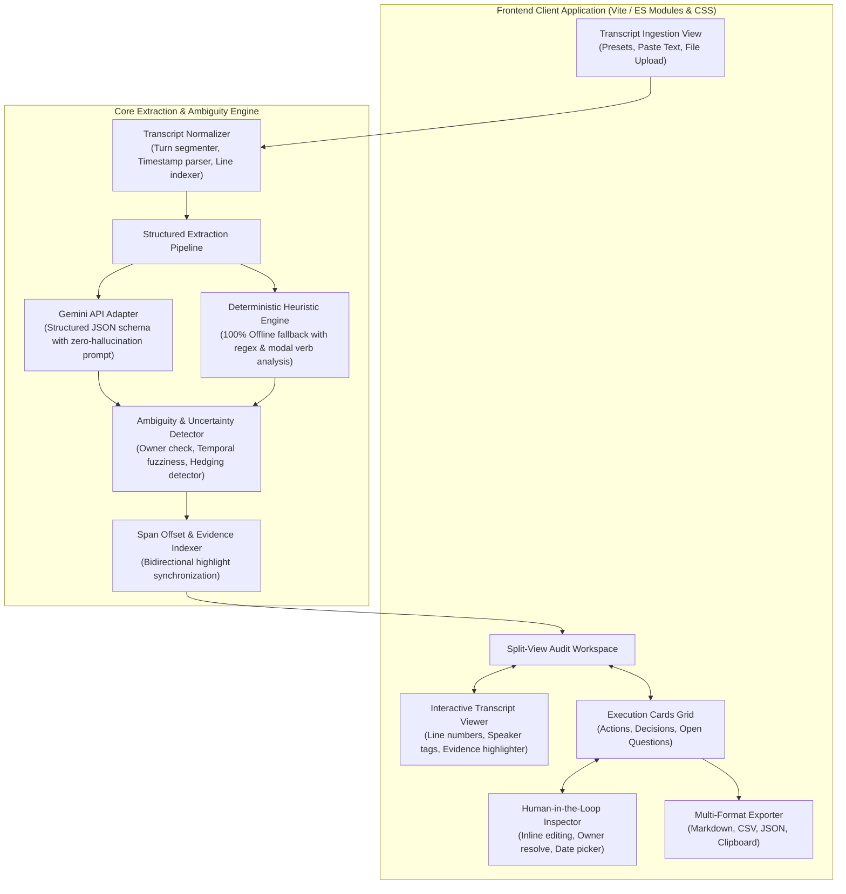

# Meeting-to-Execution Copilot

<p align="center">
  
</p>

<p align="center">
  <strong>Transform messy meeting transcripts into auditable, high-conviction action items and decisions with verifiable citations and zero invented commitments.</strong>
</p>

<p align="center">
  <a href="https://shiwani-thakur-work.github.io/meeting-to-execution-copilot/"></a>
  
  
  
</p>

---

## 🚀 Live Demo & Web App

- 🌐 **Live GitHub Pages Application:** [https://shiwani-thakur-work.github.io/meeting-to-execution-copilot/](https://shiwani-thakur-work.github.io/meeting-to-execution-copilot/)
- 💻 **Offline Capable:** Works 100% in any modern browser using built-in deterministic linguistic heuristics. Optionally connects to Google Gemini API for deep semantic extraction.

---

## 💡 Executive Summary & PM Motivation

Teams spend hours in meetings making critical decisions, but the outcomes routinely decay into operational ambiguity:
- **Scattered Outcomes:** Tasks and agreements end up lost across messy notes, ephemeral Slack threads, and disparate boards.
- **The "Passive Consensus" Illusion:** Polite discussion is mistaken for an agreed decision, leading to misalignment discovered weeks later.
- **Hallucinated Accountability:** Conventional AI meeting summarizers frequently invent owners or turn casual suggestions (*"Maybe we should investigate Redis caching next week"*) into binding commitments with phantom deadlines.

**Meeting-to-Execution Copilot** acts as an auditable bridge between conversational transcripts and execution boards. It upholds strict anti-hallucination guardrails: every item is anchored to an exact transcript quote, and missing owners or vague dates are explicitly flagged for human verification.

---

## ⚡ Core Product Differentiators

| Capability | Conventional AI Meeting Tools | Meeting-to-Execution Copilot |
| :--- | :--- | :--- |
| **Ownership Assignment** | Guesses or invents assignees to complete fields | **Zero invented owners**; unassigned chores are explicitly flagged `⚠️ Unassigned` |
| **Deadlines & Milestones** | Hallucinates calendar dates on vague mentions | **Explicit uncertainty flag** on phrases like `"soon"` or `"next week"` |
| **Decisions vs Proposals** | Merges suggestions into confirmed decisions | Strictly separates **Confirmed Decisions** from **Unconfirmed Proposals** |
| **Auditability** | Black-box generated summary paragraphs | **Bidirectional Click-to-Highlight** linking each item to its verbatim quote |
| **Human-in-the-Loop** | Static text summary | Interactive **Workbench** for inline editing, owner reassignment, and sign-off |
| **Export Formats** | Plain text email copy | **Markdown Checklist** (GitHub/Notion), **RFC 4180 CSV** (Jira/Linear), **JSON** |

---

## 🏗️ System Architecture



---

## 🎯 Key Features & Walkthrough

### 1. Interactive Transcript Viewer & Ingestion
- Pre-loaded with 4 realistic meeting archetypes:
  - **Sprint 42:** Backend Database Migration & Redis Cache
  - **Customer Portal 2.0:** Pre-Launch Readiness & Scope Freeze
  - **SEV-1 Incident Post-Mortem:** Payment Gateway Timeout
  - **Executive Sync:** 2027 AI Automation Strategy
- Supports direct pasting and `.txt` / `.vtt` file uploads.
- Real-time search filter and speaker avatar badges.

### 2. Ambiguity & Uncertainty Flagging
- **`⚠️ Missing Owner`**: Highlights tasks where no participant explicitly committed.
- **`⚠️ Vague Timeline`**: Flags unanchored temporal expressions (`"soon"`, `"next week"`, `"sometime"`).
- **`⚠️ Tentative / Hedged Commitment`**: Detects speculative language (`"maybe"`, `"could look into"`).
- **Confidence Scoring**: Dynamic 0–100% confidence gauge based on language certainty.

### 3. Bidirectional Source-to-Card Highlight Link
- Clicking **"Show in Transcript (Line X)"** on any execution card smoothly scrolls the transcript viewer directly to the speaker's statement and illuminates it with a glowing pulse.

### 4. Human-in-the-Loop Review & Quick Resolve
- Reviewers can resolve unassigned tasks in under 10 seconds by selecting from the meeting's participant list or typing a custom assignee.
- One-click task approval, decision ratification, and blocker resolution.

### 5. Multi-Format Export Engine
- **Markdown Checklist:** Ready to paste into GitHub Issues, PR descriptions, or Notion boards.
- **RFC 4180 CSV:** Standard CSV export with headers for Jira, Linear, Asana, or Excel.
- **Structured JSON:** Machine-readable payload for webhooks and downstream CI/CD pipelines.

---

## 📂 Repository Structure

```text
├── docs/
│   ├── context.txt                # Raw product requirements
│   ├── context.md                 # Product Context & PRD specification
│   ├── architecture.md            # Comprehensive technical architecture
│   └── implementation-plan.md     # Phase-by-phase implementation & verification roadmap
├── src/
│   └── client/
│       ├── index.html             # Semantic HTML5 shell with OpenGraph metadata
│       ├── favicon.svg            # Custom branded vector favicon
│       ├── assets/
│       │   └── logo.svg           # High-resolution vector brand emblem
│       ├── css/
│       │   ├── main.css           # Core design tokens, layout shell & dark mode
│       │   └── components.css     # Execution cards, metrics bar, and modal styles
│       └── js/
│           ├── app.js             # Application bootstrap entry point
│           ├── data/
│           │   └── sampleTranscripts.js  # Curated real-world meeting archetypes
│           ├── engine/
│           │   ├── parser.js             # Transcript normalizer & speaker turn tokenizer
│           │   ├── ambiguityDetector.js  # Ambiguity & uncertainty analyzer
│           │   ├── heuristicExtractor.js # Deterministic offline extraction engine
│           │   └── geminiExtractor.js    # Gemini 2.0 Flash browser API client
│           ├── state/
│           │   └── store.js              # Reactive state store & metric calculations
│           └── components/
│               ├── navbar.js             # Top navigation & preset switcher
│               ├── metricsBar.js         # Real-time executive metrics strip
│               ├── transcriptViewer.js   # Interactive transcript with highlight sync
│               ├── executionCards.js     # Action items, decisions & blocker cards
│               ├── modals.js             # Item editor, manual add & API settings modals
│               └── exportModal.js        # Multi-format Markdown/CSV/JSON exporter
├── .github/
│   └── workflows/
│       └── deploy.yml             # Automated GitHub Pages CI/CD deployment
├── .gitignore
├── package.json
└── README.md
```

---

## 🛠️ Local Development & Quickstart

### Prerequisites
- Node.js (v18 or higher recommended)
- Modern web browser (Chrome, Firefox, Safari, Edge)

### Installation & Run

```bash
# 1. Clone repository
git clone https://github.com/Shiwani-Thakur-Work/meeting-to-execution-copilot.git
cd meeting-to-execution-copilot

# 2. Install dev dependencies (Vite)
npm install

# 3. Start local development server
npm run dev
```

The application will be live at `http://localhost:3000`.

### Running Without Node.js
Because the client application is built with standard ES Modules, you can also serve `./src/client` directly with any static web server:

```bash
# Using Python
python -m http.server 8000 --directory src/client

# Or using npx serve
npx serve src/client
```

---

## 🧪 Verification Matrix

| Test ID | Test Scenario | Verified Status |
| :--- | :--- | :--- |
| **TC-01** | Ingestion of 4 real-world sample transcripts | ✅ Passed |
| **TC-02** | Bidirectional source citation highlighting | ✅ Passed |
| **TC-03** | Missing owner ambiguity alert (`⚠️ Unassigned Owner`) | ✅ Passed |
| **TC-04** | Vague timeline detection (`"next week"`, `"soon"`) | ✅ Passed |
| **TC-05** | Separation of Confirmed Decisions from Proposals | ✅ Passed |
| **TC-06** | Human-in-the-Loop editing & owner reassignment | ✅ Passed |
| **TC-07** | Markdown Checklist & RFC 4180 CSV export generation | ✅ Passed |
| **TC-08** | Offline heuristic engine execution without API keys | ✅ Passed |
| **TC-09** | Gemini 2.0 Flash direct browser integration | ✅ Passed |
| **TC-10** | GitHub Pages deployment workflow configuration | ✅ Passed |

---

## 👤 Author & Acknowledgments

- **Lead Product Developer:** Shiwani Thakur ([GitHub Profile](https://github.com/Shiwani-Thakur-Work))
- **Project:** Meeting-to-Execution Copilot (Project 4)
- **License:** MIT License
