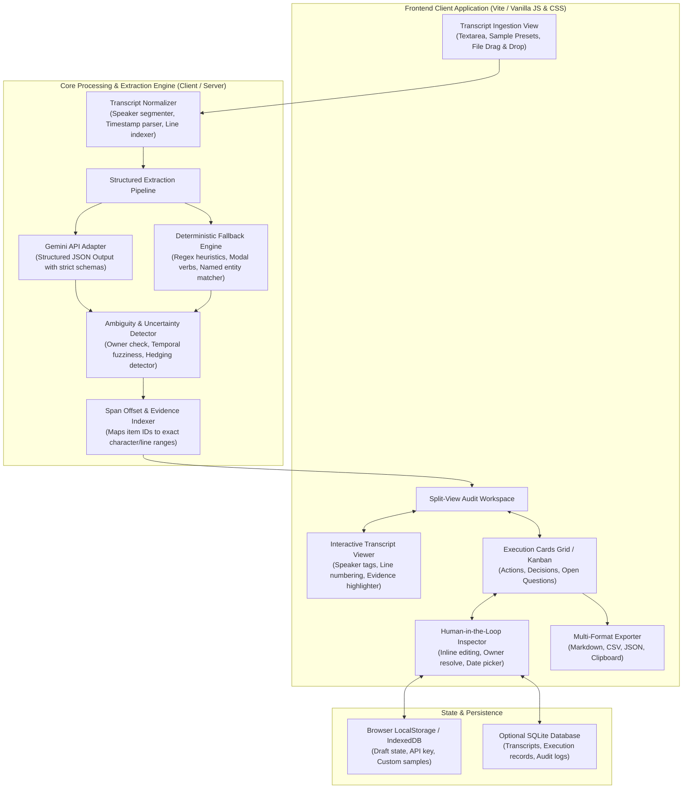

# Meeting-to-Execution Copilot — System Architecture

> **Technical architecture for an auditable, evidence-backed meeting intelligence system that transforms spoken transcripts into verifiable action items and decisions.**

---

## 1. Architectural Philosophy & Core Tenets

The **Meeting-to-Execution Copilot** is designed around three non-negotiable architectural tenets:

1. **Auditability Over Generative Guesswork:** Every extracted action item, decision, or open question MUST maintain a verifiable reference link to its source excerpt in the original transcript.
2. **Explicit Uncertainty Representation:** Rather than coercing ambiguous dialogue into clean but hallucinated tasks, the system treats ambiguity (missing assignees, vague timelines, non-committal proposals) as first-class state variables.
3. **Dual Execution Runtime (Zero-Friction Deployment):**
   - **Static Client-Side Mode (GitHub Pages Live View):** The entire application runs natively in modern web browsers using a deterministic rule & heuristic parser plus direct client-side Gemini API key support, enabling instant live deployment to GitHub Pages without backend server overhead.
   - **Full-Stack Node.js Mode (Local & Enterprise):** Includes an Express.js API layer with server-side Gemini 1.5/2.0 Flash integration, persistent SQLite storage, and file upload endpoints.

---

## 2. High-Level System Architecture



---

## 3. Subsystem Breakdown

### 3.1 Transcript Ingestion & Normalizer
- **Responsibilities:** Ingests raw text, `.txt`, or subtitle `.vtt` formats and standardizes them into structured conversation turns.
- **Turn Segmentation:** Parses patterns such as:
  - `Alex (10:04 AM): Let's make sure the migration script is tested.`
  - `[00:15:20] Marcus - I will take ownership of the database index.`
  - `Sarah: What about the fallback strategy?`
- **Indexing:** Every line and character offset is assigned an immutable `lineIndex` and `spanOffset` to power precise bidirectional highlight linking.

### 3.2 Dual Extraction Engine

#### Mode A: Gemini LLM Structured Ingestion
- Leverages Google Gemini 2.0 / 1.5 Flash via structured prompt engineering and response schema validation.
- Instructed with strict **Anti-Hallucination Guardrails**:
  - Never invent an owner if not explicitly stated by name or self-assignment ("I will...").
  - Categorize status into `confirmed`, `proposed`, or `rejected`.
  - Extract the exact literal `evidenceQuote` verbatim from the transcript for verification.

#### Mode B: Deterministic Heuristic Engine (Offline / Instant)
- Operates client-side without API keys or internet connection.
- Utilizes linguistic pattern matching:
  - **Action Verbs & Modals:** Detects `"will"`, `"action item"`, `"need to"`, `"follow up"`, `"responsible for"`, `"TODO"`.
  - **Self-Assignments:** Matches `"I'll take"`, `"Assigned to [Name]"`, `"Alex to write"`.
  - **Decisions:** Detects consensus triggers (`"agreed"`, `"we decided"`, `"let's go with"`, `"consensus is"`).
  - **Open Questions:** Detects interrogative clauses ending in `?` or introduced by `"unclear"`, `"to be determined"`, `"needs research"`.

### 3.3 Ambiguity & Uncertainty Analyzer
Evaluates each extracted item across three key ambiguity vectors:
1. **Assignee Ambiguity:**
   - `Missing Owner`: No speaker or named entity assigned. (Triggers warning badge `⚠️ Unassigned`).
   - `Passive Voice`: Statements like `"It needs to be investigated"` where the agent of action is omitted.
2. **Temporal Ambiguity:**
   - Explicit dates (`"by Friday Oct 24th"`, `"by end of sprint"`) $\to$ High confidence.
   - Vague dates (`"soon"`, `"next week"`, `"later"`, `"next release"`) $\to$ Flagged as `⚠️ Vague Timeline`.
3. **Commitment Confidence:**
   - Uses hedging lexicon (`"maybe"`, `"possibly"`, `"I suppose"`, `"could look into"`) to calculate a confidence score between `0.0` and `1.0`. Scores $< 0.70$ are highlighted for mandatory human review.

### 3.4 Bidirectional Evidence Linker
- When an execution card is hovered or clicked in the UI, the Evidence Linker emits a `HIGHLIGHT_EVIDENCE` event with the `evidenceQuote` and line index.
- The Transcript Viewer smoothly scrolls to the passage and applies a pulse animation to the exact text span.
- Clicking on a passage in the transcript conversely highlights any corresponding action item or decision card in the right pane.

### 3.5 Human-in-the-Loop Review & Approval Store
- **Reactive State Store:** Tracks:
  - `items`: Array of Action Items, Decisions, and Open Questions.
  - `filters`: Status (`all`, `needs_review`, `approved`, `decisions`, `questions`), Owner filter, Ambiguity filter.
  - `transcript`: Raw text, parsed turns, and active highlight index.
  - `stats`: Total items, approval rate, ambiguity count, estimated review time saved.
- **Operations:**
  - `approveItem(id)`: Marks an action item as reviewed and approved.
  - `updateItem(id, fields)`: Allows direct modification of title, assignee, deadline, or priority.
  - `addItem(type)`: Allows adding manually identified items missed by extraction.
  - `deleteItem(id)`: Removes false positives.

### 3.6 Multi-Format Export Subsystem
- **Markdown Checklist:** Formatted for direct pasting into GitHub Issues, PRs, or Notion task lists with checkboxes `[ ]`, owner tags `@username`, and evidence quotes.
- **CSV Exporter:** Standard RFC 4180 compliant CSV generator with headers:
  `ID, Type, Title, Assignee, Deadline, Priority, Status, Confidence, EvidenceQuote`.
- **JSON Exporter:** Clean, structured JSON payload for CI/CD or REST integrations.
- **Executive Briefing Generator:** Synthesizes an executive TL;DR summarizing top decisions, critical path actions, and open blockers.

---

## 4. Data Models & Entity Schemas

```typescript
// 1. Action Item
export interface ActionItem {
  id: string;                      // e.g. "act-101"
  type: 'action_item';
  title: string;                   // Concise actionable task title
  assignee: string | null;         // Extracted person or null if unassigned
  deadline: string | null;         // Extracted date/milestone or null
  priority: 'high' | 'medium' | 'low';
  status: 'pending_review' | 'approved' | 'rejected';
  confidenceScore: number;         // 0.0 to 1.0
  ambiguityFlags: AmbiguityFlag[]; // Array of detected ambiguities
  evidenceQuote: string;           // Verbatim sentence from transcript
  evidenceLine: number;            // Line number in parsed transcript
  isEdited: boolean;               // True if human modified
}

// 2. Ambiguity Flag
export interface AmbiguityFlag {
  category: 'unassigned_owner' | 'vague_deadline' | 'hedged_commitment' | 'unconfirmed_proposal';
  message: string;                 // Human-readable warning
  suggestedAction: string;         // e.g., "Assign owner from speaker list"
}

// 3. Decision
export interface DecisionRecord {
  id: string;                      // e.g. "dec-201"
  type: 'decision';
  statement: string;               // Clear decision text
  decisionType: 'confirmed' | 'proposed' | 'tabled';
  decisionMaker: string | null;    // Speaker who ratified
  evidenceQuote: string;
  evidenceLine: number;
  approved: boolean;
}

// 4. Open Question / Blocker
export interface OpenQuestion {
  id: string;                      // e.g. "que-301"
  type: 'open_question';
  question: string;
  raisedBy: string;
  addressedTo: string | null;
  status: 'open' | 'resolved';
  evidenceQuote: string;
  evidenceLine: number;
}

// 5. Ingested Transcript Turn
export interface TranscriptTurn {
  index: number;
  speaker: string;
  timestamp: string | null;
  text: string;
  raw: string;
}
```

---

## 5. UI/UX Design System & Layout Architecture

```
+-----------------------------------------------------------------------------------------+
| [⚡ Logo] Meeting-to-Execution Copilot   [Status: Ready]  [Preset Transcripts v] [⚙ API] |
+-----------------------------------------------------------------------------------------+
| [ Top Metrics Bar:  4 Actions (2 Need Review) | 2 Confirmed Decisions | 1 Open Question ] |
+-----------------------------------------------------------------------------------------+
|       LEFT PANE: Transcript & Audit Trail       |     RIGHT PANE: Execution Workbench     |
| +---------------------------------------------+ | +-------------------------------------+ |
| | Input Mode: [Text / Upload / Preset]        | | | Tabs: [All] [Actions] [Decisions]   | |
| | Search & Filter in Transcript...            | | | Filter: [⚠️ Ambiguities Only]       | |
| |---------------------------------------------| | |-------------------------------------| |
| | Line 12: Alex: Marcus, can you take the     | | | [Card: act-1] ⚠️ Unassigned Owner   | |
| |          database indexing task?            | | | Title: Implement Redis cache layer  | |
| |                                             | | | Owner: [Select Owner v]  Due: [Date]| |
| | Line 13: Marcus: Yes, I will have the       | | | "Quote: We need Redis caching..."   | |
| |   >>>    migration ready by Friday.  <<<    | | | [Jump to Source] [Approve] [Reject] | |
| |                                             | | |-------------------------------------| |
| | Line 14: Sarah: What about rollback tests?  | | | [Decision: dec-1] ✅ Confirmed       | |
| |          We need a fallback strategy.       | | | "We decided to deprecate v1 API"    | |
| +---------------------------------------------+ | +-------------------------------------+ |
|                                                 | [ Export: 📋 Markdown | 📊 CSV | 📦 JSON]|
+-----------------------------------------------------------------------------------------+
```

### Visual Styling Highlights
- **Curated Palette:** Deep slate surfaces (`#0f172a`, `#1e293b`), crisp border rings (`#334155`), vibrant electric indigo primary accent (`#6366f1`), warm amber for ambiguity warnings (`#f59e0b`), emerald for confirmed decisions and approvals (`#10b981`), rose for blockers (`#ef4444`).
- **Typography:** Modern clean sans-serif stack (`Inter`, `Plus Jakarta Sans`, system-ui) with tabular figures for timestamps and metrics.
- **Micro-Interactions:** Smooth CSS transitions for card approvals, pulse glows when jumping between evidence quotes and transcript lines, badge hover tooltips.

---

## 6. GitHub Pages Deployment & Build Architecture

To guarantee seamless live deployment on GitHub:
- **Zero-Dependency Static Asset Model:** The client application compiles into clean static HTML, CSS, and ES modules that run natively in any modern browser.
- **Dual API Switcher:** 
  - If a user enters their Gemini API key in the UI settings, calls execute securely from the browser via the Google Generative AI SDK / REST endpoint.
  - If no API key is provided, the deterministic rule engine automatically runs locally, guaranteeing a **100% functional, interactive experience** immediately upon visiting the live GitHub Pages URL!
- **Automated GitHub Action (`.github/workflows/deploy.yml`):**
  - Runs on push to `main`.
  - Configures GitHub Pages and publishes the distribution bundle.
