# Meeting-to-Execution Copilot — Implementation Plan

> **Phase-by-phase implementation blueprint for building, testing, branding, and deploying the Meeting-to-Execution Copilot web application.**

---

## 1. Plan Overview & Objectives

This implementation plan outlines the exact sequence to take the **Meeting-to-Execution Copilot** from product requirements (`context.md`) and technical design (`architecture.md`) into a fully functional, production-ready, beautifully branded web application that is prepared for live GitHub Pages deployment.

### Key Deliverables
1. **Production-Ready Web Application:**
   - Client SPA with responsive split-screen audit workbench.
   - Dual-mode extraction: Deterministic offline rule engine + optional Gemini API integration.
   - Deep evidence linking with interactive transcript highlighting.
   - Ambiguity and uncertainty detection (unassigned owners, vague dates, low-confidence statements).
   - Full human-in-the-loop review, inline editing, and multi-format export (Markdown, CSV, JSON).
2. **Professional Branding & Metadata:**
   - Custom SVG logo and branded favicon.
   - Comprehensive OpenGraph and Twitter card meta tags for portfolio presentation.
   - Clean, modern SaaS aesthetic with dark mode and vibrant accents.
3. **CI/CD & Live Deployment:**
   - GitHub Actions workflow (`deploy.yml`) for automated zero-config GitHub Pages hosting.
   - Comprehensive `README.md` with PM case study, workflow diagrams, and portfolio walkthrough.

---

## 2. Phase-by-Phase Roadmap

```mermaid
gantt
    title Meeting-to-Execution Copilot Implementation Phases
    dateFormat  X
    axisFormat %d
    section Phase 1: Scaffolding
    Directory Structure & Configs      :p1_1, 0, 1
    Branding Assets & Logo SVG         :p1_2, 1, 2
    section Phase 2: Engine
    Transcript Normalizer & Parser    :p2_1, 2, 3
    Ambiguity & Uncertainty Detector  :p2_2, 3, 4
    Deterministic Extraction Engine   :p2_3, 4, 5
    Gemini AI Client Integration      :p2_4, 5, 6
    section Phase 3: UI
    Core Layout & Split View Workspace:p3_1, 6, 7
    Interactive Transcript & Highlighter:p3_2, 7, 8
    Execution Cards & Review Inspector:p3_3, 8, 9
    section Phase 4: Export
    Export Engine (CSV, MD, JSON)     :p4_1, 9, 10
    Preset Meeting Transcripts        :p4_2, 10, 11
    section Phase 5: Deployment
    CI/CD Workflow & GitHub Pages     :p5_1, 11, 12
    README & Portfolio Documentation  :p5_2, 12, 13
```



---

## 3. Detailed Work Breakdown Structure (WBS)

### Phase 1: Project Scaffolding, Package Setup & Branding
- **Step 1.1:** Setup `package.json` with scripts for local development (`npm run dev`), build (`npm run build`), and preview.
- **Step 1.2:** Establish clean directory structure:
  ```text
  ├── docs/
  │   ├── context.txt
  │   ├── context.md
  │   ├── architecture.md
  │   └── implementation-plan.md
  ├── src/
  │   ├── client/
  │   │   ├── index.html
  │   │   ├── favicon.svg
  │   │   ├── assets/
  │   │   │   └── logo.svg
  │   │   ├── css/
  │   │   │   ├── main.css
  │   │   │   └── components.css
  │   │   └── js/
  │   │       ├── app.js
  │   │       ├── config.js
  │   │       ├── engine/
  │   │       │   ├── parser.js
  │   │       │   ├── ambiguityDetector.js
  │   │       │   ├── heuristicExtractor.js
  │   │       │   └── geminiExtractor.js
  │   │       ├── data/
  │   │       │   └── sampleTranscripts.js
  │   │       ├── components/
  │   │       │   ├── navbar.js
  │   │       │   ├── metricsBar.js
  │   │       │   ├── transcriptViewer.js
  │   │       │   ├── executionCards.js
  │   │       │   ├── itemEditorModal.js
  │   │       │   └── exportModal.js
  │   │       └── state/
  │   │           └── store.js
  ├── .github/
  │   └── workflows/
  │       └── deploy.yml
  ├── .gitignore
  └── README.md
  ```
- **Step 1.3:** Create custom branding vector (`logo.svg` and `favicon.svg`) representing an execution checklist intersected with meeting soundwaves.
- **Step 1.4:** Craft SEO, OpenGraph, and Twitter card meta tags in `index.html`.

### Phase 2: Core Processing, Ambiguity & Extraction Engines
- **Step 2.1:** Implement `parser.js`:
  - Recognizes speaker names, timestamps `[HH:MM]`, line indices, and paragraphs.
  - Generates tokenized turns with source offset mappings.
- **Step 2.2:** Implement `ambiguityDetector.js`:
  - Evaluates unassigned owners, vague temporal markers (`"soon"`, `"next week"`), passive phrasing, and hedging keywords.
  - Assigns severity scores and actionable mitigation suggestions.
- **Step 2.3:** Implement `heuristicExtractor.js`:
  - Robust regex rules and keyword clustering to extract Action Items, Decisions, and Open Questions offline with 100% reliability.
  - Matches exact quotes and character ranges.
- **Step 2.4:** Implement `geminiExtractor.js`:
  - Browser-direct integration supporting user-provided Gemini API keys.
  - Structured prompt with strict JSON schema enforcing anti-hallucination rules.
- **Step 2.5:** Create `sampleTranscripts.js`:
  - Curate 4 realistic, distinct transcripts (Sprint Planning, Cross-functional Product Sync, Post-Mortem Incident Review, Executive Roadmap Sync).

### Phase 3: Interactive UI & Split-View Review Workbench
- **Step 3.1:** Implement design system tokens in `main.css`:
  - Curated slate/indigo palette, modern typography, glassmorphism card surfaces, accessible contrast ratios.
- **Step 3.2:** Build `navbar.js` and `metricsBar.js`:
  - Logo, preset picker, API Key settings modal trigger, real-time counters (Pending Review, Confirmed Decisions, Ambiguity Alerts, Time Saved).
- **Step 3.3:** Build `transcriptViewer.js`:
  - Line numbers, speaker badges, timestamp pills, search/filter bar, and smooth scroll target with glowing evidence pulse.
- **Step 3.4:** Build `executionCards.js`:
  - Categorized tabbed views (All Items, Action Items, Decisions, Open Questions).
  - Ambiguity badges with warning icons.
  - Direct actions: "Jump to Evidence Quote", "Approve", "Edit", "Delete".
- **Step 3.5:** Build `itemEditorModal.js`:
  - Human-in-the-loop drawer to edit title, select owner from speaker list, set explicit deadline, or toggle resolution status.

### Phase 4: Multi-Format Export Engine
- **Step 4.1:** Implement `exportModal.js`:
  - Markdown checklist formatter (ready for GitHub/Notion).
  - RFC 4180 standard CSV generator with downloadable file trigger.
  - JSON exporter for technical workflows.
  - One-click clipboard copy with visual toast confirmation.

### Phase 5: GitHub Pages CI/CD & Documentation
- **Step 5.1:** Configure `.github/workflows/deploy.yml` with permissions for GitHub Pages deployment.
- **Step 5.2:** Create production `README.md` containing:
  - Project overview, PM motivation, core problems solved.
  - Interactive live demo link badge.
  - Architecture breakdown, screenshots/diagrams, and setup instructions.
- **Step 5.3:** Initialize Git, commit all code with professional semantic commit messages, and prepare GitHub push.

---

## 4. Verification & Testing Matrix

| Test ID | Test Scenario | Expected Outcome |
| :--- | :--- | :--- |
| **TC-01** | Load Preset Transcripts | Ingestion completes within 100ms; all turns correctly parsed with speaker tags. |
| **TC-02** | Evidence Quote Highlight | Clicking "Show in Transcript" scrolls transcript viewer to exact line and animates highlight. |
| **TC-03** | Ambiguity Flagging | Unassigned tasks ("Someone needs to test this") trigger `⚠️ Unassigned Owner` badge. |
| **TC-04** | Vague Date Flagging | Tasks with "next week" or "soon" are flagged as `⚠️ Vague Timeline`. |
| **TC-05** | Human-in-the-Loop Edit | Modifying owner/deadline updates card and metric counters immediately. |
| **TC-06** | Export Integrity | Exported CSV and Markdown match approved items with correct column headers and quotation marks. |
| **TC-07** | Offline Fallback | Application works 100% without Gemini API key using deterministic extraction engine. |
| **TC-08** | Gemini API Ingestion | Valid Gemini API key successfully calls model and returns structured execution schema. |
| **TC-09** | Responsive Layout | Fluid adaptation across desktop monitors, laptops, and mobile viewports. |
| **TC-10** | GitHub Pages Build | Workflow succeeds and serves static bundle with no 404s or broken relative paths. |
